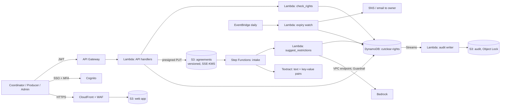

# Cutclear: proposed AWS architecture

Status: this is a design, not a running system. The website and the prototype at `/app` are static front ends. The code in `backend/` has been unit-tested locally and shares its fixtures with the prototype engine. Nothing is deployed. The services match the website's architecture section: S3, Textract, Bedrock, Lambda, DynamoDB and EventBridge.

## 1. Overview

| Concern | Decision |
|---|---|
| Identity | Cognito, optionally federated. Groups: `coordinator`, `producer`, `admin`. |
| Authorisation | Handlers re-check the role and tenant on every call, mirroring `src/app/actions.js`. Producers get only their cut and the requests addressed to them; findings, decisions and agreement wording are never returned to them. Admins get aggregates. |
| Agreements | Uploaded to versioned S3 through presigned URLs. Textract extracts the text. Extracted permission fields start *unconfirmed* and do not count until a coordinator confirms them against the wording. |
| Checks | `backend/lambdas/check_rights`: hierarchical territories, channels, licence start and end, seconds per use, paid media, and required credits. Same fixtures as the prototype. |
| AI | `backend/lambdas/suggest_restrictions`: Bedrock Converse with a Guardrail. Only the wording and the confirmed fields are sent. Each suggestion must quote the wording and use an allowed kind. |
| Plan versions | Every release-plan change is a new version. Decisions and sign-off store the version they were given for, and any change clears them. |
| Expiry | A daily EventBridge job finds confirmed licences ending within the policy window for live releases and notifies the owner. The prototype's dashboard shows the same list. |
| Audit | DynamoDB Streams feed S3 with Object Lock. |

## 2. Data model (DynamoDB single table `cutclear-rights`)

| Item | PK | SK | Attributes |
|---|---|---|---|
| Production | `T#<tenant>#P#<id>` | `META` | title, client, owner, status, `GSI1PK=T#<tenant>#STATUS#<status>`, `GSI1SK=<releaseEnd>` |
| Plan version | same | `PLAN#v<n>` | start, end, territories, channels, paidMedia |
| Asset | same | `ASSET#<id>` | name, type, usedSeconds, decision {type, note, by, at, planVersion} |
| Agreement | same | `AGR#<asset>#v<n>` | ref, s3Key, sha256, excerpt, fields, confirmed, confirmedBy |
| Credit | same | `CREDIT#<n>` | text |
| Request | same | `REQ#<id>` | assetId, kind, note, done, `GSI2PK=T#<tenant>#U#<producer>` |
| Suggestion | same | `AI#<id>` | kind, quote, decision, reason, model_id, prompt_version |
| Sign-off | same | `SIGNOFF` | planVersion, by, at, second, secondAt |
| Expiry index | `T#<tenant>#EXP` | `<licenceEnd>#<prod>#<asset>` | for the daily range query |

Sign-off uses `TransactWriteItems` with conditions that the plan version and every asset decision are unchanged, and that the second signer differs from the first.

## 3. AI controls

1. AI only flags wording; checks and decisions are rules and people.
2. No production, client, fee or people data is sent (`check_input`).
3. Quotes must exist verbatim in the wording and kinds must be in the allowed list; malformed output fails closed.
4. Pending until a coordinator decides; a dismissal needs a reason.
5. A per-tenant switch; the confirmation rate is shown on the admin overview.
6. Use Bedrock under terms that exclude customer content from training, and record this in the data-processing agreement.

## 4. Security and retention

KMS on DynamoDB, S3 and logs; TLS 1.2+; VPC endpoints for Bedrock and Textract; least-privilege IAM with tenant `LeadingKeys` conditions; malware scanning of uploads; and logs with IDs only. Proposed defaults: agreements and decisions kept for the licence term plus 7 years (confirm per customer), exports for 30 days, the audit log for 7 years.

## 5. Not legal advice

Cutclear compares recorded terms with a plan and records people's decisions. It does not clear rights or replace legal review.
